# Secure Trade Mediation System

An escrow-based marketplace that reduces e-commerce fraud. A buyer, a seller and a
delivery agent trade through a platform that locks money in escrow and penalizes
whoever breaks the deal.

Rebuilt from my earlier Python prototype (FastAPI + Streamlit) as a full-stack app with
Java, Spring Boot, MySQL and React. The original work was published in IJSART.

**Live demo:** _coming soon_

## How the money logic works

Every user has a **regular wallet** and an **escrow wallet**.

1. A buyer places an order. **Prepaid** locks 100% of the price; **cash on delivery** locks 10%.
2. The seller agrees and locks a **10% security deposit**.
3. The delivery agent marks the order in transit, then delivered.
4. The buyer confirms receipt, and the seller is paid and gets the deposit back.

If someone breaks the deal, a **10% penalty** is applied and split **7% to the harmed party and 3% to the delivery agent**. The offender also loses 0.1 reputation.

Example with a ₹1,000 order:

| Who | Role in the dispute | Amount |
|---|---|---|
| Offender | Pays the 10% penalty | −₹100 |
| Harmed party | Receives 7% | +₹70 |
| Delivery agent | Receives 3% | +₹30 |
| **Total** | | **₹0** (no money is created or lost) |

| Event | Result |
|---|---|
| Buyer cancels after the seller agreed | Buyer pays the penalty; seller gets 7%, agent 3%; seller's deposit is released |
| Seller cancels after agreeing | Buyer fully refunded; seller's deposit is forfeited (7% to the buyer, 3% to the agent) |
| Return judged reasonable | Buyer fully refunded; seller's deposit is forfeited |
| Return judged not reasonable | Buyer pays the penalty; seller's deposit is released |

### Order lifecycle

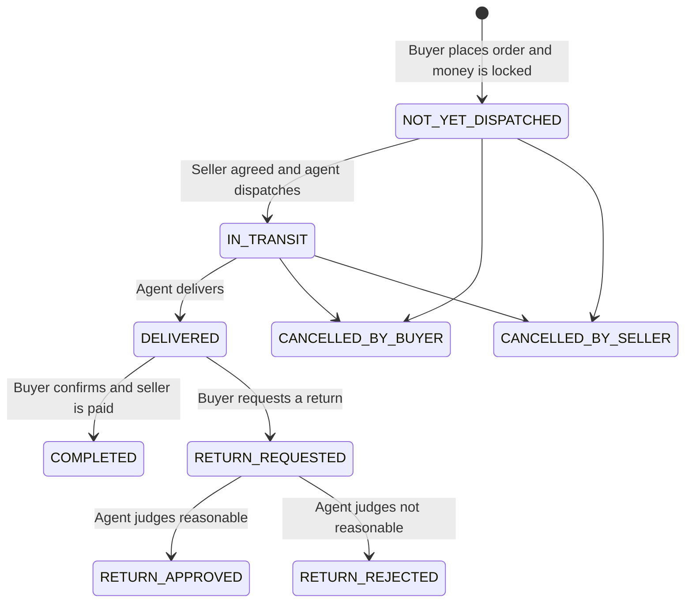

## Screenshots: the logic step by step

| Step | Screenshot | What it shows |
|---|---|---|
| 1 | 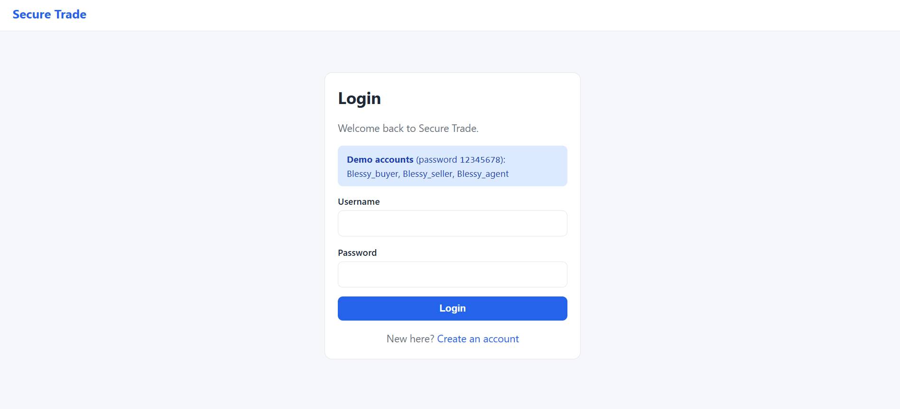 | The login page, where buyers, sellers and the delivery agent sign in with JWT-secured accounts. |
| 2 | 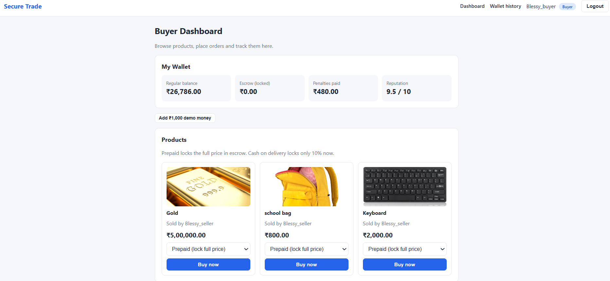 | The buyer dashboard with the wallet card, product list and My Orders table. |
| 3 | 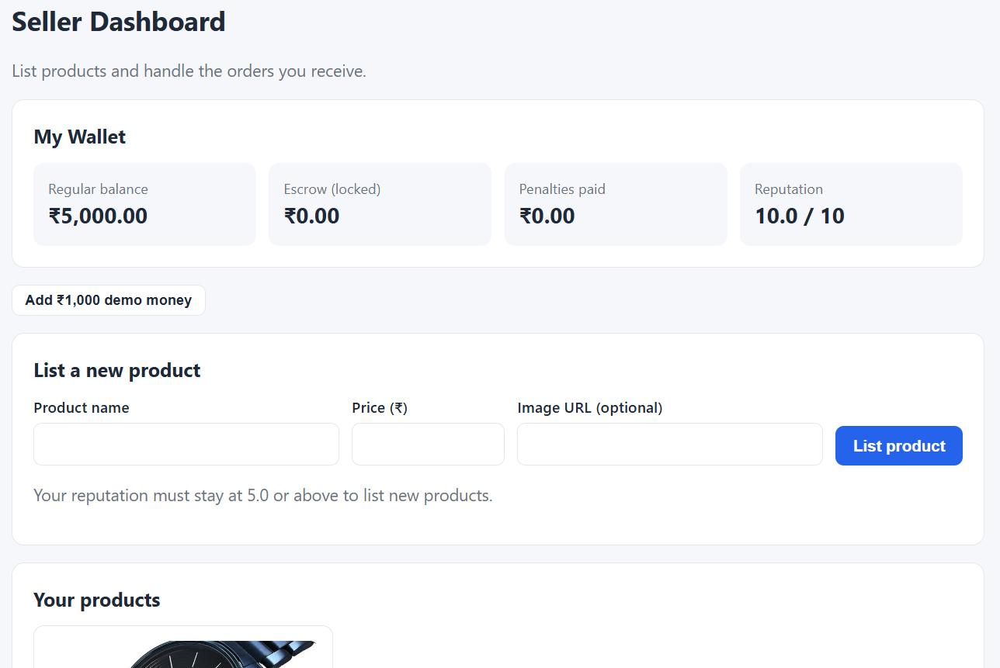 | The seller dashboard for listing products and handling incoming orders. |
| 4 | 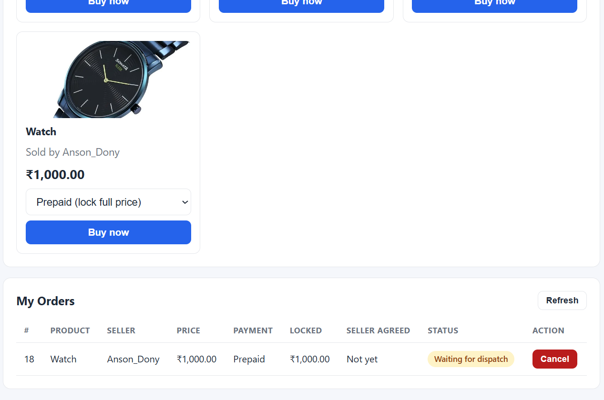 | A prepaid order, where the buyer's full price moves from the regular wallet into escrow. |
| 5 | 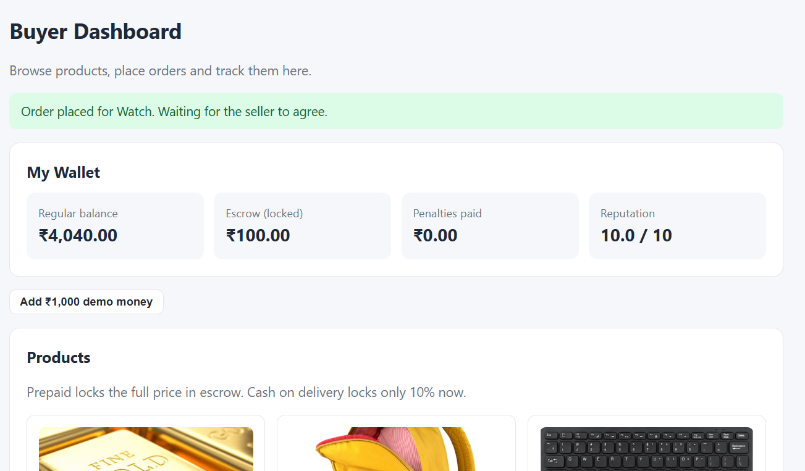 | A cash-on-delivery order, where only 10% of the price is locked in escrow and the rest is paid in cash on delivery. |
| 6 | 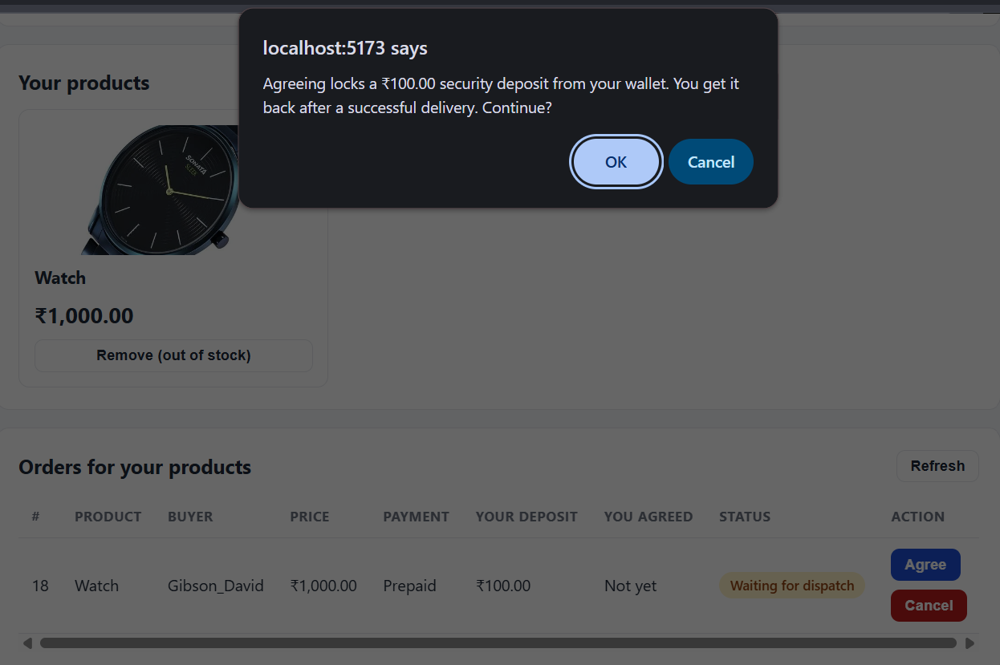 | The seller agrees to the order and is told that a 10% security deposit will be locked. |
| 7 | 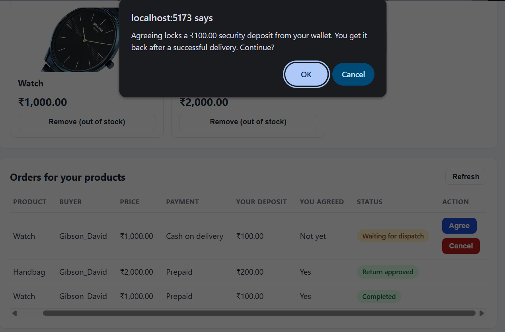 | The seller's wallet after agreeing to a cash-on-delivery order, with the 10% deposit moved into escrow. |
| 8 | 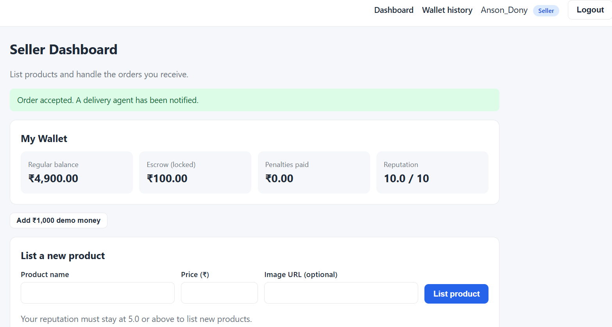 | The seller's deposit locked in escrow, which protects the buyer if the seller breaks the deal. |
| 9 | 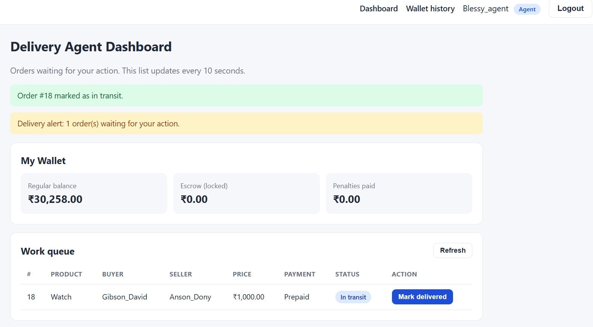 | The delivery agent marks the order in transit and then delivered, while the money stays safe in escrow. |
| 10 | 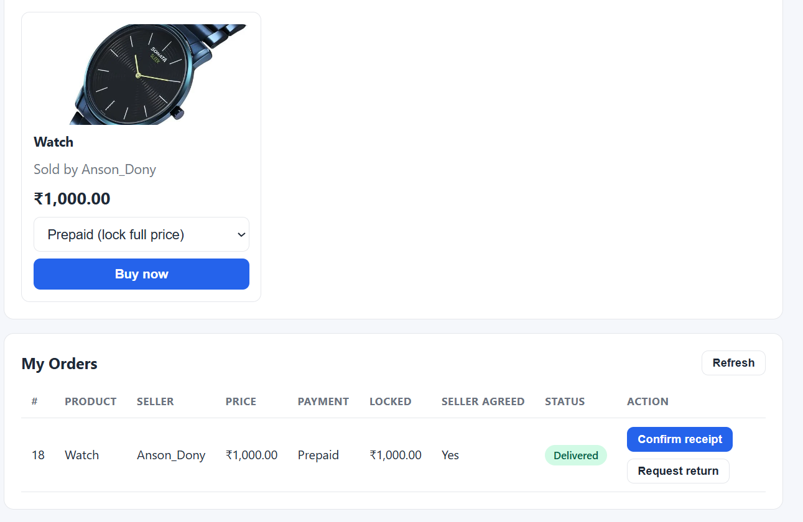 | The buyer confirms receipt, so the seller is paid and the seller's deposit is returned. |
| 11 | 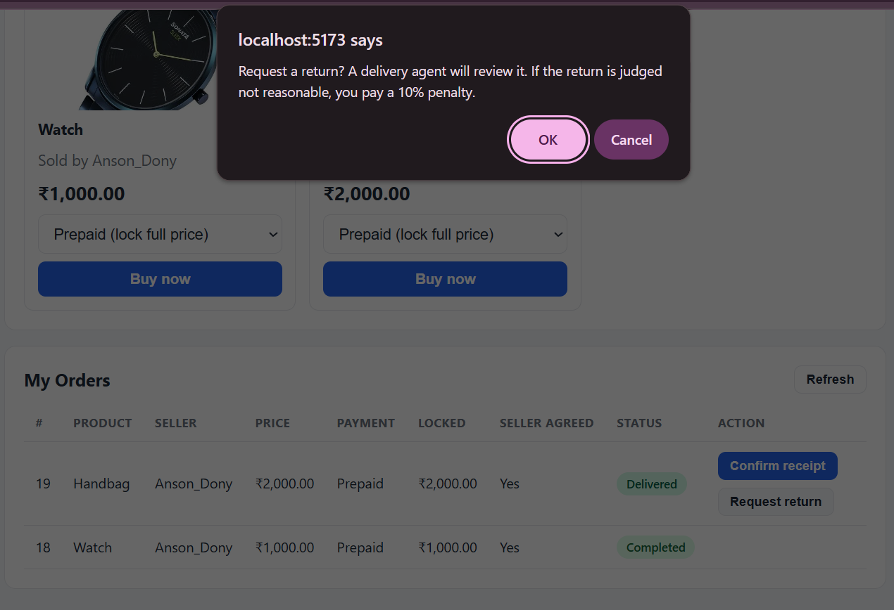 | The buyer requests a return after delivery, which sends the order to the delivery agent's review queue. |
| 12 | 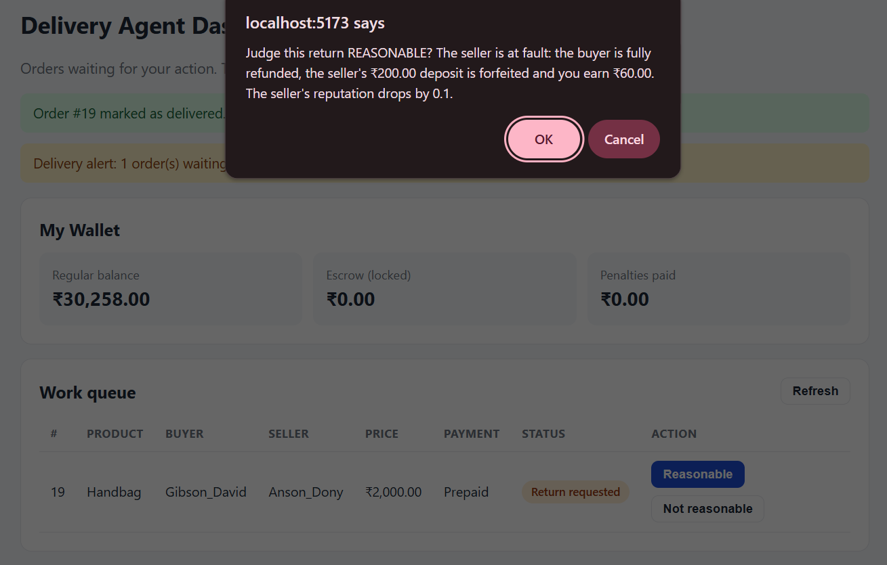 | The agent judges the return reasonable, so the buyer is fully refunded and the seller's deposit is forfeited (7% to the buyer, 3% to the agent). |
| 13 | 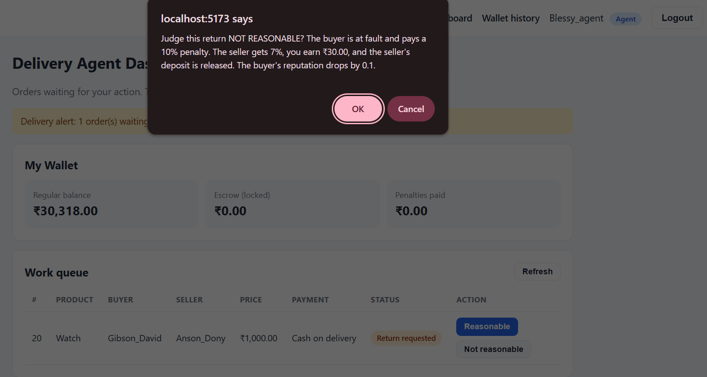 | The agent judges the return not reasonable, so the buyer pays the 10% penalty (7% to the seller, 3% to the agent) and the seller's deposit is returned. |
| 14 | 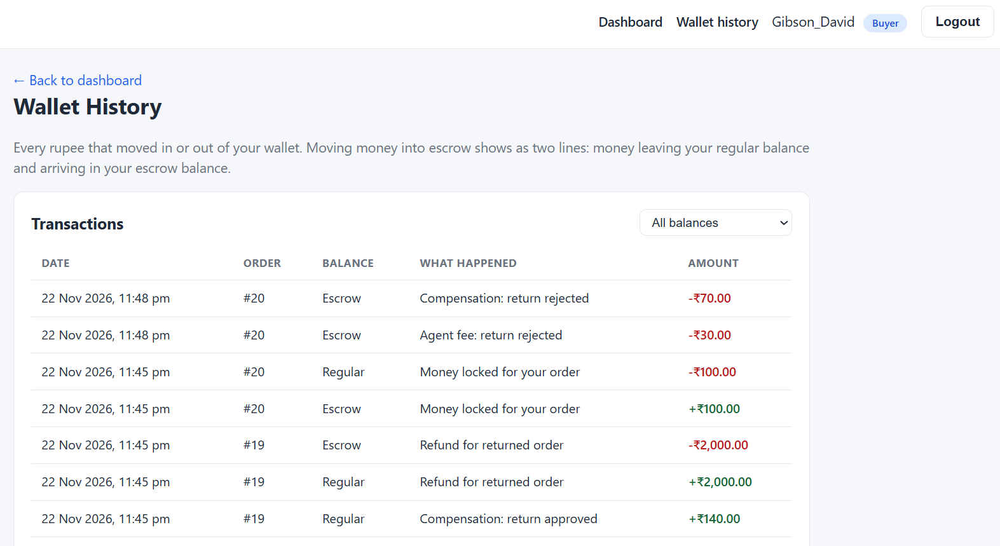 | The buyer's wallet history, listing every rupee that moved, taken from the double-entry ledger. |
| 15 | 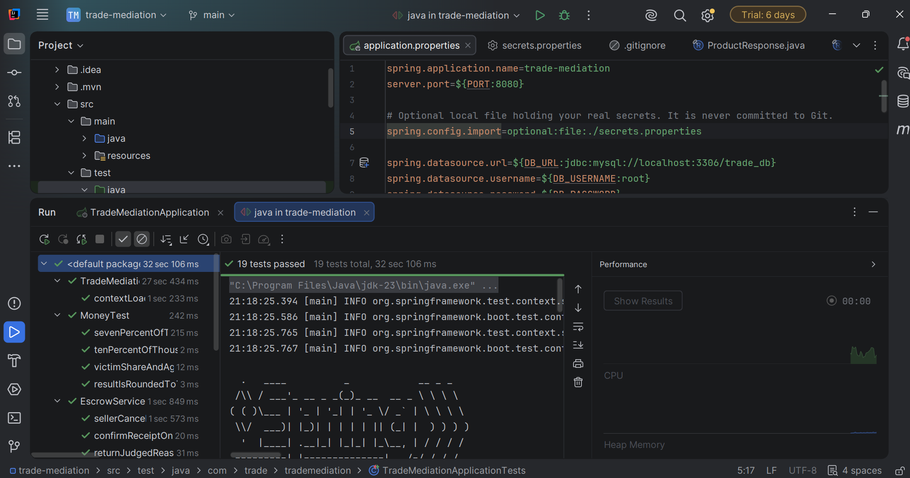 | All 19 automated tests passing, covering the 10%, 7% and 3% penalty rules. |

The penalty logic lives in
[`EscrowService.java`](trade-mediation/src/main/java/com/trade/trademediation/service/EscrowService.java),
and its tests are in
[`EscrowServiceTest.java`](trade-mediation/src/test/java/com/trade/trademediation/service/EscrowServiceTest.java).

## Tech stack

- **Backend:** Java, Spring Boot 4, Spring Security (JWT + BCrypt, role-based access), Spring Data JPA / Hibernate, MySQL
- **Frontend:** React, React Router, Axios
- **Quality:** JUnit 5, Mockito, Swagger/OpenAPI, Actuator health check

## Engineering highlights

- **Money safety:** all amounts use `BigDecimal`, and every money move runs in one database transaction, so a failure never leaves money half-moved.
- **Double-entry ledger:** every movement is recorded and the ledger always sums to zero. Users can see their own history.
- **Concurrency:** pessimistic locking on orders and optimistic locking on wallets stop double-clicks from paying twice.
- **State machine:** every order action checks that the order is in a valid state and who is calling.
- **Server-side security:** roles are enforced on the server, and the Agent role cannot be self-registered.
- **Tested rules:** unit tests cover the 10% / 7% / 3% maths, COD edge cases, reputation limits and rejected actions.

## Run locally

**Requirements:** JDK 17+, Node.js LTS, MySQL 8

1. Create the database: `CREATE DATABASE trade_db;`
2. Run the table script in `trade-mediation/docs/schema.sql`.
3. Create `trade-mediation/secrets.properties`:
   ```
   DB_PASSWORD=your_mysql_password
   ```
4. Start the backend: `cd trade-mediation`, then `.\mvnw.cmd spring-boot:run` (port 8080).
5. Start the frontend: `cd trade-frontend`, copy `.env.example` to `.env`, then `npm install` and `npm run dev` (port 5173).

Demo accounts (password `12345678`): `Blessy_buyer`, `Blessy_seller`, `Blessy_agent`.

API docs: http://localhost:8080/swagger-ui/index.html

## Tests

```
cd trade-mediation
.\mvnw.cmd test
```

## Security notes

- Passwords are hashed with BCrypt. No secrets are committed; configuration comes from environment variables.
- Demo accounts and the demo top-up endpoint are enabled only when `app.demo-mode=true` and must be turned off in production.
- Dependencies are scanned; test-scope alerts are not shipped, and runtime advisories are handled by upgrading Spring Boot patch versions.

## Possible improvements

- Wallet top-up and withdrawal through a payment gateway such as Razorpay
- Automatic release of escrow after a delay if the buyer does not respond
- Integration tests with Testcontainers
- WebSocket notifications for the agent instead of polling
- Product stock levels and search
